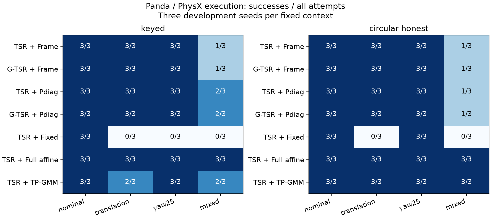

# 第一轮 Panda 物理执行证据

2026-09-30。完成168次新的 PhysX 执行、全部原始轨迹核验和结果汇总。

**冻结响应已经接入机械臂实际动作，但本轮没有证明 G-TSR + Pdiag 优于强基线。
Full affine 在两类任务的12次尝试中均成功；Pdiag 分别为11/12和10/12。**

这里“成功”沿用环境判据：位置误差<12 mm、插入轴误差<0.15 rad，并且未触发统一100 N净接触力停机。
环境触发成功即终止，不能据此声称精确达到最终插入深度。以上均为仿真，没有真机实验。

## 1. 新增了什么

- 同一 Panda、同一 PhysX 环境、同一抓取与目标执行流程。
- 两个任务分支，名义/平移/25°轴向旋转/六维混合四个固定环境条件。
- 三个新执行 seed，每条件每方法一次，无成功后筛选、失败删除或自适应重试。
- 核心四组为 `TSR/PoE G-TSR × Frame/Pdiag`，加上 Fixed、Full affine、TP-GMM SE(3)。
- 单个旧 N=30训练子集供所有学习方法使用；新增执行不参与拟合。
- 预测目标转换成 IK/关节轨迹，再由 PhysX 与关节位置控制器执行。
  每段目标使用当前实测 peg/TCP 位姿修正抓持偏差。

本轮是**开发阶段的执行桥接与等价几何对照**。
每个任务/方法的12次尝试来自3个 seed×4个固定条件，并非12个独立任务；不做显著性声明。
目标区域是共同的局部控制容差，不声称已经识别任务允许集合 Z。

## 2. 完整结果

| 方法 | keyed 成功次数 | circular 成功次数 |
|---|---:|---:|
| TSR + Frame | 10/12 | 10/12 |
| G-TSR + Frame | 10/12 | 10/12 |
| TSR + Pdiag | 11/12 | 10/12 |
| G-TSR + Pdiag | 11/12 | 10/12 |
| TSR + Fixed | 3/12 | 6/12 |
| TSR + Full affine | **12/12** | **12/12** |
| TSR + TP-GMM SE(3) | 10/12 | **12/12** |

各条件、接触力与退出原因见[完整表格](tables.md)。数据源见 `summary.json`。
全部168次中137次成功，31次未成功。31次分别为25次力阈值退出、5次执行完预定动作仍未成功、
1次底层规划器轨迹时间参数化异常。不能将最后一种失败解释为响应模型的预测错误。

两种几何表示在本轮的可行坐标完全等价，逐条件成功次数也一致。
这符合传统 TSR 作为特例的兼容预期，不是耦合几何优势证据。
不能把核心四组中相同物理条件的复制运行合并成更大的独立样本量。

## 3. 对论文主张的影响

### 获得的新证据

1. 学习响应可以通过统一接口驱动真实的仿真机器人执行，已超出离线轨迹误差比较。
2. 在本轮固定条件下，响应适应有实际用途：Fixed 的成功次数明显少于几个响应方法。
   这一结果不把适应能力独占归因于 Pdiag；Frame 和完整学习基线同样具备它。
3. 传统 TSR 可表达时，PoE 区域与其目标一致，未出现本轮几何兼容性退化。

### 没有得到支持的主张

- Pdiag 普遍比完整模型更准确、更容易完成任务。
- G-TSR 几何推广已经在耦合物理任务中带来成功率或时间优势。
- 仅凭学习到的响应即可恢复任务必要约束，或无需执行反馈便可保证可行性。
- 三个开发 seed 可以支撑跨物体、跨控制器、真机泛化或独立确认结论。

因此，这轮结果应作为检验方法边界的证据保留；不能只报告 Pdiag 胜过 Fixed。

## 4. 下一轮需要先处理的具体问题

失败诊断见 `verification.json` 的 `failure_diagnostics`。
有8次 keyed 失败记录显示，程序已推进到阶段5或6，但键部仍未达到清除条件。
这说明**程序阶段推进不等于物理任务进展**；这些记录本身不证明它是所有失败的原因。
Pdiag 也有在进入阶段已经发生阻塞的情况，需要同时检查预测目标与物理约束的关系。

后续按以下顺序补齐，不修改这批结果：

1. **核对目标、约束和阶段的接口。** 在单独版本中记录预测位姿到任务可行集的偏差，
   用物理事件确认阶段转移。几何真值门控只作 oracle 诊断，不能包装成在线观察者。
2. **接入完整受约束规划。** 当前 mplib 只处理机器人自碰撞，未导入完整场景几何。
   补关节空间场景碰撞、连续边检查和端到端预算，再进入耦合任务比较。
3. **增加独立耦合物理场景。** 对比单 TSR、合适的 TSRChain/多区域、TSR加耦合修正、G-TSR；
   在同一任务上做几何×响应消融。不能用本轮等价区域对照代替该实验。
4. **在线阶段与确认集。** 按 Sprint G 解除阶段已知假设；方法与评价方案冻结后再收集确认数据。

## 5. 核验

- 168/168预定单元都有 JSON 和完整 HDF5，无缺失或被丢弃的失败。
- HDF5 中动作数、状态数、成功标记、距离、轴误差、接触力与汇总逐项一致。
- 144组初始状态对照完全相同，包括关节位置、peg pose和socket pose。
- 两种几何表示的1,110个共同中心目标最大差异为0。
- 800个冻结 Pdiag 动作与生产 `ResponseOperator` 的最大矩阵元素差为 `1.66e-14` 以下。
- 执行输入与33个源码/数据文件的哈希核对通过；输出HDF5/JSON逐文件哈希已保存。
- 66项相关测试通过，包括7项新增桥接/失败记录测试；Ruff通过。
- 独立代码审查覆盖预算、失败分母、阶段与旋转约定、来源记录和报告逻辑。

这些是实现和记录核验，不提升实验的统计独立性，也不代替缺失的耦合物理实验。
mplib 没有公开的种子接口，因此不声称随机规划路径可跨运行逐位复现。

## 文件

- [协议](protocol.md)、[配置](protocol.json)、[复现说明](reproduce.md)。
- `execution/`：168次执行的HDF5、JSON、日志与开始标记。
- `targets.npz`、`preparation.json`：冻结动作、训练来源与软件版本。
- `verification.json`、`summary.json`、[完整表](tables.md)。
- `figures/`：PNG、SVG和PDF，已检查图像布局。
- `source_snapshot/`：正式批次源码副本；`smoke/`与`preparation_v1/`保留开发历史。

本轮没有改动 Sprint G 范围契约、生产几何/响应内核和兄弟仓库。
