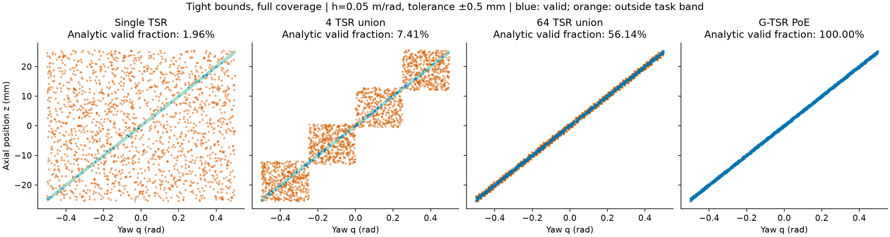
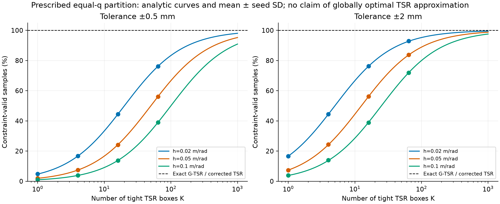
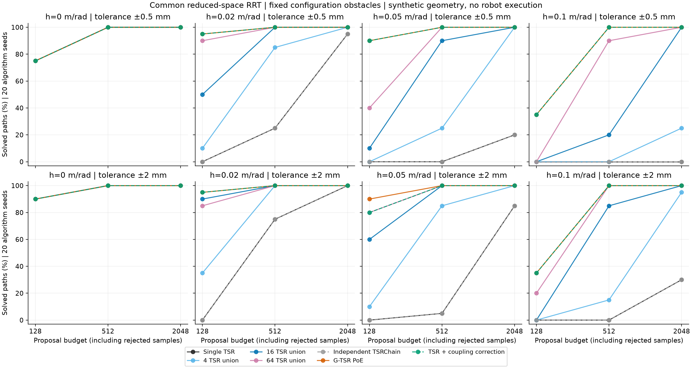

# 新一轮：TSR 与 G-TSR 的直接几何比较

2026-09-30。已完成解析推导、实现、运行和结果核验。
范围是有明确真值的合成约束与简化配置空间规划；没有机械臂、IK、物体接触或闭环执行。
本轮单独保存，未修改当前打开的 Sprint G 在线阶段估计契约，也未修改生产几何内核。

## 核心结果

**在规定的螺旋约束族中，G-TSR 能直接生成约束内样本，减少紧致传统 TSR 包围盒的无效提议，改善共同 RRT 的有限提议预算内求解率。增加 TSR 区域数量或提供显式耦合修正可以缩小差距。**

这个结论支持表示与采样效率的联系，不支持“G-TSR 全面优于所有 TSR 系统”。
“TSR + 耦合修正”的强参照在主要预算上也能全部求解，必须保留在论文中。

## 1. 做了什么

- 8 个固定场景：螺距 h 为 0、0.02、0.05、0.1 m/rad，容差为 ±0.5、±2 mm。
- 7 种方法：单 TSR，4/16/64 个 TSR 的并集，一个明确的独立坐标 TSRChain，G-TSR PoE，TSR 加耦合修正。
- 20 个配对算法随机 seed；每方法每场景每 seed 10,000 个几何样本。
- 相同 RRT、障碍物、步长、距离度量和目标偏置；所有提议包括拒绝都消耗预算。
- 共 **1,120 个运行单元，3,360 个预算检查点**；同一运行的三个检查点不独立。

任务带为 `|z-hq|≤epsilon`，不是零厚度曲线。TSR 边界使用真实任务带的紧致包围盒，
不沿用旧演示中扩大20倍的轴向范围。所有方法获得相同的已知几何，不涉及学习几何的样本效率。
规划障碍是 `(x,q)` 配置矩形，路径在三坐标 SE(3) 子空间中搜索；它不是 CBiRRT 或完整机器人规划系统。

## 2. 理论与数值对应

将角区间（长度 L）等分为 K 段，每段使用覆盖完整任务带的最紧 canonical TSR 盒。
该规定构造下的采样有效率为：

\[
p_K=\frac{2\epsilon}{|h|L/K+2\epsilon}.
\]

这是精确积分结果，证明与适用范围见 [理论推导](theory.md)。
全部采样汇总与理论值的最大差异为 **0.204 个百分点**。
增加 K 不遗漏可行运动：每组的解析覆盖率为100%，独立可行查询的实测覆盖率也全部为100%。

以 h=0.05 m/rad、L=1 rad、容差±0.5 mm为例：

| 方法 | 实测约束内样本比例 | 128 提议内求解 | 512 提议内求解 | 2048 提议内求解 |
|---|---:|---:|---:|---:|
| 单 TSR | 1.950% | 0/20 | 0/20 | 4/20 |
| 4 个 TSR 并集 | 7.453% | 0/20 | 5/20 | 20/20 |
| 16 个 TSR 并集 | 24.111% | 2/20 | 18/20 | 20/20 |
| 64 个 TSR 并集 | 56.037% | 8/20 | 20/20 | 20/20 |
| 独立坐标 TSRChain | 1.950% | 0/20 | 0/20 | 4/20 |
| G-TSR PoE | 100% | 18/20 | 20/20 | 20/20 |
| TSR + 显式耦合修正 | 100% | 18/20 | 20/20 | 20/20 |

这张表用于解释机制，不代表只评价该场景。完整8个场景见 [全部表格](tables.md) 与下图。
所谓“约束内”只指几何任务带；规划中的额外障碍检查仍可能拒绝样本或边。



对该例，若要求上述并集构造的采样有效率达到95%，需要至少950个等分盒。
这是特定近似方式的复杂度结果，不是任意 frame、任意 TSRChain 或任意非均匀划分的全局最优下界。



## 3. 全场景结果与反例

**传统 TSR 可精确表达时，方法恢复同样行为。** h=0的两个场景中，所有方法在配对 seed 下的
求解状态、消耗提议数、节点数与路径一致（浮点容差内）；两个场景在512提议内均为20/20。
这是该合成对照下的行为兼容，不证明所有任务的规划开销相同。

**耦合约束下，紧致单盒仍会浪费提议。** 在六个非零螺距场景中，单 TSR 在512提议内的求解次数为
5、15、0、1、0、0（依次为 h=0.02/0.05/0.1，每个 h 先±0.5 mm后±2 mm），
G-TSR 和耦合修正方法均为20/20。

**更多传统区域可以追回求解率。** 64区域并集在512提议下的六个场景为20、20、20、20、18、20；
16区域并集在2048提议下全部为20/20。这说明比较必须同时报告区域数量和预算。

**G-TSR 也会在小预算下失败。** h=0.1的两个场景中，128提议下只有7/20，
所以精确的区域采样本身并不保证有限预算规划成功。



图中部分曲线重合：独立坐标 chain 与单 TSR 的采样分布相同；h=0时所有方法一致。
没有对任意 TSRChain 最优表达能力作结论，也没有隐藏显式修正参照。

## 4. 这轮新增了什么论文证据

| 命题 | 证据与状态 |
|---|---|
| 单个合法传统 TSR 是 G-TSR 特例 | 既有构造证明与兼容测试；本轮增加 h=0 规划对照 |
| G-TSR 可精确表达特定耦合约束带 | PoE 构造，生产前向 API 对照，覆盖与约束检查 |
| 紧致传统盒的无效采样如何随容差和区域数量变化 | 本轮解析公式与完整参数网格数值核对 |
| 采样差异能否影响规划 | 共同简化 RRT 中的预算曲线，所有失败保留 |
| G-TSR 比带耦合处理的完整系统更好 | 未支持；显式修正参照能匹配主要预算下的求解率 |
| 几何推广改善真实操作任务 | 未验证；还缺关节空间规划、动力学/接触和执行 |

可以据此将论点推进为：**生成元表示把耦合关系直接放进区域参数化；在已知耦合约束的合成任务中，
它以单个区域完成传统紧致盒需要区域细分或额外修正才能达到的高效约束内采样。**
这是表示紧凑性与提议效率的证据，不是新规划器最优性、控制器优越性或新物体泛化的证据。

## 5. 核验和计量限制

- 快速映射与仓库实际 TSR、指定 TSRChain、GTSR/PoEChart 前向映射逐项一致。
- 已对每条保存的成功路径检查起终点、连续线段障碍、任务带和独立137点/边密集采样。
  最大带约束超出量为 `8.68e-18 m` 以下，处于浮点误差量级。
- 输入源码与协议 SHA 未变；1,120个唯一运行单元全部保存，规划失败计入分母。
- 算法 seed 只刻画固定问题上的随机搜索波动，不等于20个独立任务或物理执行 seed。
- 使用等提议数预算，不是等墙钟时间。优化后的向量化采样器不能用来宣称生产 API 更快。
  `sampler_seconds`计时整个2048样本池，`planning_seconds`计搜索到停止；不将二者相加包装成每个预算的端到端耗时。
- 错误接受率是对“共同单盒内的无效查询”的条件统计，不是任意空间分布的假阳性率。

## 6. 下一轮的具体入口

1. 将这组已知几何接入同一机械臂的关节空间规划和连续碰撞检查，以等墙钟预算补充本轮提议预算。
2. 对实际任务选择有竞争力的 TSRChain/多区域构造，而不是把本轮独立坐标 chain 当作最强传统方法。
3. 在同一任务中做“TSR/G-TSR区域 × 共同预设响应/学习Pdiag”的四组消融，明确收益来自哪一部分。
4. 完成几何比较后，再按独立 Sprint G 契约解除 oracle phase 假设；本轮没有改变其确认实验条件。

## 文件与复现

- [运行协议](protocol.md)、[精确配置](protocol.json)、[理论推导](theory.md)。
- [完整结果表](tables.md)、[汇总 JSON](results/summary.json)、[所有输出核验与 SHA](results/verification.json)。
- `results/cells/`保存1,120份逐运行记录，包括失败状态与成功路径。
- 图保存为PNG/SVG/PDF；报告脚本会重新核对输入 SHA 和所有成功路径。

```bash
env -u PYTHONPATH OPENBLAS_NUM_THREADS=1 OMP_NUM_THREADS=1 \
  /home/rocos/miniconda3/envs/tsr-dev/bin/python scripts/benchmark_gtsr_geometry.py \
  --protocol docs/researchwrite/gtsr-tsr-geometry-2026-09-30/protocol.json \
  --out docs/researchwrite/gtsr-tsr-geometry-2026-09-30/results

env -u PYTHONPATH OPENBLAS_NUM_THREADS=1 OMP_NUM_THREADS=1 \
  /home/rocos/miniconda3/envs/tsr-dev/bin/python scripts/report_gtsr_geometry.py \
  --directory docs/researchwrite/gtsr-tsr-geometry-2026-09-30
```

缓存拒绝输入漂移；修改配置或基准脚本时另建结果目录。独立代码审查确认解析公式、
预算口径、连续边检查和比较范围无阻塞问题，审查提出的查询分布与计时边界已纳入本报告。
