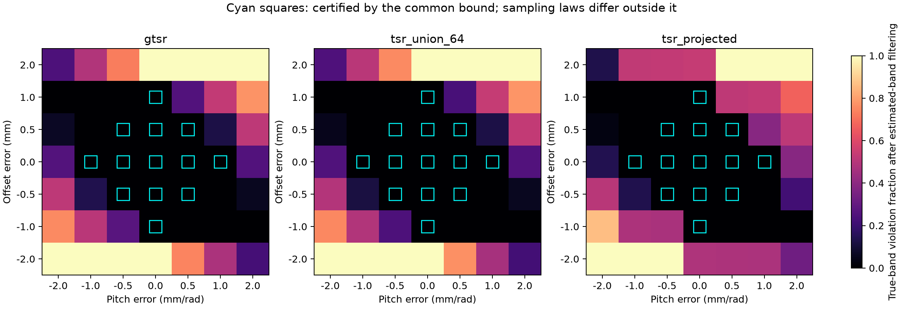

# 几何估计误差保证：验证结论

**所提充分条件成立，而且三种方法共享它。它保证命令目标位于指定约束带内，
不能直接预测机器人任务成功率，也不是 G-TSR 独有的鲁棒性优势。**

本轮完成证明、48 组顶点极值检查、735 格生产采样比较（188160 个提议）、
4900 组三方法共享坐标对照、30 次 Panda / PhysX 执行。
此前六个研究目录的 **4005 个文件哈希均未变化**。

## 1. 数学结论

令命令 `z_c=b_hat+h_hat θ_c+η`，满足 `|η|≤ρ`、`θ_c∈[0,Q]`。
则

\[
|z_c-b-h\theta_c|
=|\Delta b+\Delta h\theta_c+\eta|
\le\delta_b+Q\delta_h+\rho.
\]

因此 `δ_b+Qδ_h+ρ≤ε` 是目标带内的充分条件。
在独立盒状不确定性和完整命令域下，可构造端点取等，所以这个统一最坏界是紧的。
对一个已固定的有符号误差，更紧的界是

\[
\rho+\max\{|\Delta b|,|\Delta b+Q\Delta h|\}.
\]

误差相互抵消时，即使统一条件不成立，也可能全部可行。[完整证明](theory.md)。

## 2. 生产采样器的直接验证

固定 `Q=1 rad, ε=1.5 mm, ρ=.5 mm`。
在正负截距/螺距误差网格中，每种方法有 65 个“满足充分条件”的格子：

| 方法 | 满足估计带前提的样本 | 真实带违例 |
|---|---:|---:|
| G-TSR | 16640 | **0** |
| TSR＋显式轴向修正 | 16640 | **0** |
| 64 TSR＋估计带过滤 | 8797 | **0** |

64 TSR 的原始包围盒提议中有 **1112 个真实带违例**。
它们不满足估计带前提，不能用来反驳公式；过滤后共享保证。
若坚持不做过滤，则可在上界中额外加入 `|h_hat|Q/64`。

G-TSR 和夹取修正的输出分布不同。为排除这个混淆，另用相同 `(θ,η)` 通过三个生产接口生成位姿：
4900 组对照的最大矩阵元素差为 **5.55×10⁻¹⁷**。
这支持保证来自输出满足的约束，而不是表示的名字。



图中方框是公式覆盖的离散误差组合，全部零违例；横纵轴按实际采样的离散水平排列。
方框外不同颜色受误差符号与输出采样分布共同影响，不作为方法固有鲁棒性排名。

## 3. 估计几何规划、真实几何执行

真实螺旋孔固定；规划器只获得估计相位/螺距生成的孔体。
三种方法使用共同控制器、已知入口/出口高度以及相同 100 ms 几何预算。
本轮只扰动标量截距和螺距，不覆盖完整孔位姿误差。

误差倍率 λ 对应 `Δb=.4λ mm`、`Δh=.6λ mm/rad`。
下面每行合并三方法、各两种子，共六次；三方法在这些二元结果上均一致。

| λ | 公式上界 | 有命令保证 | 完整路径目标带内 | 已记录实际孔内片段带内 | 任务成功 |
|---|---:|---|---:|---:|---:|
| 0 | .5 mm | 是 | 6/6 | 6/6 | 6/6 |
| .5 | 1.0 mm | 是 | 6/6 | 6/6 | 6/6 |
| 1 | 1.5 mm | 是 | 6/6 | 6/6 | 6/6 |
| 2 | 2.5 mm | 否 | 0/6 | 0/6 | 6/6 |
| 4 | 4.5 mm | 否 | 0/6 | 0/6 | 6/6 |

所有 30 次均完成任务，且独立重算倾斜针片顶部间隙后仍满足成功标准。
其中保证范围内的 18 次均未越带；范围外的 12 次越带但仍能完成任务。
原因是此处 ε=1.5 mm 定义了物理孔可行集的保守带；超出此带不等于碰撞或操作失败。
**当前数据没有定位物理任务的失败阈值，不能把 1.5 mm 画成成功率必然下降的临界点。**

实际残差由 HDF5 位姿独立重算，覆盖对孔、进入和退出阶段中落在名义孔深度范围内的记录。
这些是离散控制步观测，不是连续时间的轨迹认证。

## 4. 跟踪误差：还不能宣称完整执行保证

执行残差还包含跟踪项：

\[
|z_a-b-h\theta_a|
\le\delta_b+Q\delta_h+\rho+|e_z|+|h||e_\theta|.
\]

本轮对 **18090 个控制步**独立核验了该不等式，均通过。
但轨迹事后最大跟踪误差合成的上界为约 **2.34–7.33 mm**，均大于 ε。
因此本轮没有获得能够事先保证全程执行带内的控制器误差预算。
实际残差可更小，因为最坏误差未必同时出现，且误差方向可以抵消。

还需要独立给出并检验控制器的跟踪上界，才能把命令保证升级为执行保证。
此外，二维约束带不覆盖横向偏移、倾角、自碰撞、接触载荷等条件。

## 5. 对论文的含义

可以写：**在声明的误差界内，满足估计约束带的命令具有可证明的真实带内保证；
G-TSR、显式修正以及过滤后的多 TSR 均遵守此结论。**

本轮不支持“只有 G-TSR 能抵抗几何误差”，也没有通过这个通用不等式新增 G-TSR 独有贡献。
原有表示紧凑性、提议有效率与特例关系证据仍然保留。
本轮偏差人为设定，未检验如何从传感器或示教数据得到可靠的误差上界。

若继续推进，优先研究**如何估计误差界并据此收缩带宽，同时取得可用的跟踪误差预算**。
这比把共同成立的不等式包装成独有优势更能支撑论文结论。

## 证据与复现

- [协议](protocol.md)、[证明](theory.md)、[完整表格](results.md)、[结构化核验结果](summary.json)。
- `samples.json` 保留每个提议的坐标及估计/真实残差；`routes.json` 保留实际执行的完整目标路径。
- `robot/` 保存 30 份启动标记、JSON 与 HDF5，`pilots/` 保存开发探针。
- [独立审查](code_review.md)、[22 项测试](verification_tests.log)、[最终核验日志](verification_audit.log)。
- `source_snapshot/` 保存运行时源码、协议、测试；`sources.json` 包含运行依赖哈希。

从仓库根目录运行，新输出目录可使用以下命令：

```bash
env -u PYTHONPATH OPENBLAS_NUM_THREADS=1 OMP_NUM_THREADS=1 \
  /home/rocos/miniconda3/envs/maniskill_download/bin/python \
  scripts/benchmark_gtsr_uncertainty.py geometry --output NEW

env -u PYTHONPATH OPENBLAS_NUM_THREADS=1 OMP_NUM_THREADS=1 \
  /home/rocos/miniconda3/envs/maniskill_download/bin/python \
  scripts/benchmark_gtsr_uncertainty.py robot --output NEW
```

文件已存在时停止，避免覆盖或隐式重试失败格子。
