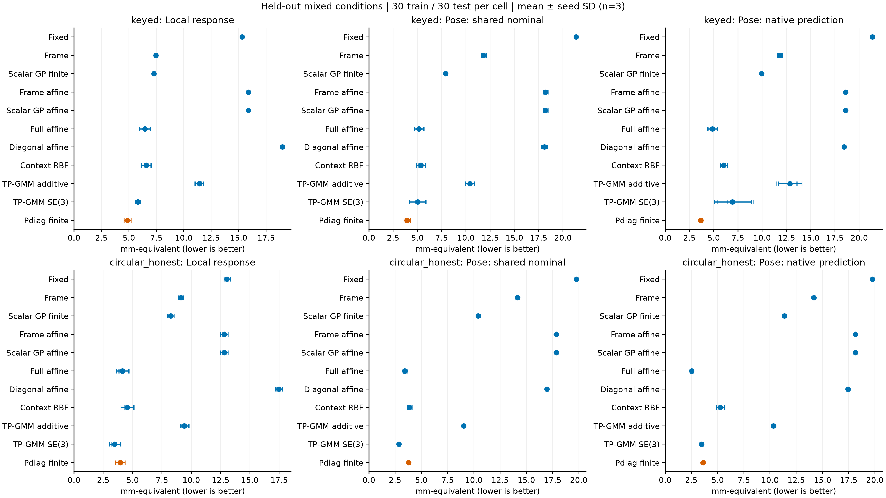
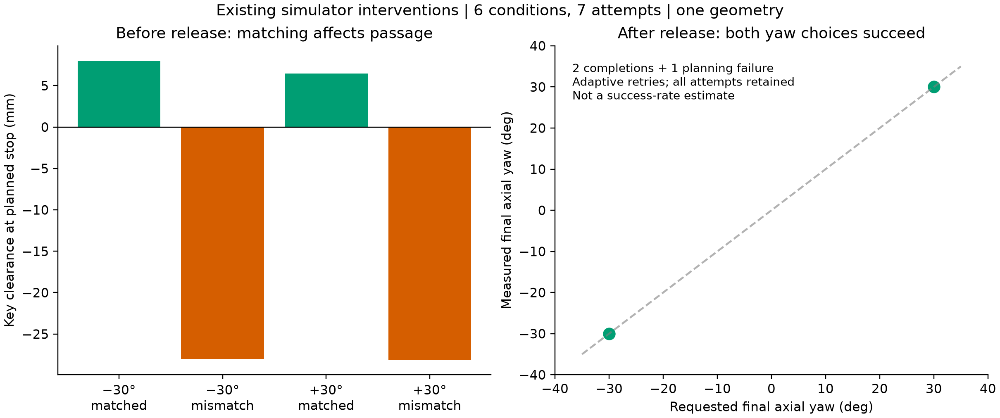

# 统一指标后，Pdiag 的优势与边界

2026-09-30。探索性开发分析；重析既有仿真轨迹，没有新增机器人或仿真闭环执行。

## 结论

**Pdiag 在当前 keyed 数据上表现最好，但 circular 的混合干预显示了它的边界。**
这轮结果支持“六维有限响应具有有效的结构约束”，不支持“Pdiag 全面优于完整基线”。
同时，**拟合出的响应描述示教控制器如何适应环境变化，不能直接等同于任务必需响应。**

11 个方法、2 个任务分支、3 个 execution seeds、6 个 N=30 子集，共 **396 个比较单元，全部成功，零警告**。
每单元用 30 条 mixed 训练，评价其余 30 条 mixed 和 14 条 isolated。
六个子集共享同一 seed 的数据；统计单位是 seed，每个分支 n=3，不是 n=18。
所有方法使用同一训练/评价划分、参考关系 frame 和共同 baseline；超参数选择只使用训练数据。
模型族的配置和调参预算不同，不能将结果解释成在等参数量或等计算预算下的最优性。

## 1. 完整比较给出了什么

下表选取主要强基线，完整 11 方法、各指标及 SD 见 [完整表](tables.md)。
这里报告留出 mixed，数值为均值 ± 跨 seed SD，单位 mm-equivalent，越低越好。
该单位包含转角加权，不等于真实位置误差或接触容差。

| 方法 | keyed：共同名义位姿 | keyed：原生位姿 | circular：共同名义位姿 | circular：原生位姿 |
|---|---:|---:|---:|---:|
| Scalar GP finite | 7.891 ± 0.149 | 9.943 ± 0.055 | 10.416 ± 0.116 | 11.351 ± 0.139 |
| Full affine | 5.153 ± 0.463 | 4.864 ± 0.493 | 3.424 ± 0.179 | **2.531 ± 0.136** |
| Context RBF | 5.361 ± 0.437 | 6.027 ± 0.354 | 3.860 ± 0.232 | 5.250 ± 0.404 |
| TP-GMM SE(3) | 5.007 ± 0.810 | 6.947 ± 1.910 | **2.870 ± 0.139** | 3.465 ± 0.131 |
| Pdiag finite | **3.939 ± 0.317** | **3.663 ± 0.086** | 3.779 ± 0.100 | 3.616 ± 0.118 |

- **keyed mixed：** Pdiag 的局部动作、共同名义位姿、原生位姿及两种任务代理的平均误差都在 11 方法中最低。对 Full affine 和 TP-GMM SE(3)，前三项优势在三个 seed 中方向一致。
- **circular mixed：** Pdiag 在共同名义位姿上比 TP-GMM SE(3) 高 0.909，在原生位姿上比 Full affine 高 1.085；两项差异都在三个 seed 中方向一致。局部动作指标也由 TP-GMM SE(3) 最低（3.461，对比 Pdiag 3.945）。
- **isolated 六 generator 等权：** Pdiag 在两个分支的五项报告指标上平均值均最低；共同名义位姿为 keyed 2.196、circular 2.367。这个优势不能替代 circular mixed 上的失败边界。

这不是显著性检验结果。当前只有三个开发 seed，没有设置新的确认性门槛，也没有把旧世界动作指标的门槛移植到新指标。
上轮平面 E09 中 Full/RBF 优于 Pdiag 的结果仍然保留；这里是不同的六维数据和模型实现，不能混为一次“排名翻转”。

图中横线为跨 seed SD，细竖线为三个 seed 的均值；每个 seed 先平均六个训练子集。
局部动作、共同名义位姿和原生预测是三个不同问题，因此全部展示，不按结果择优报告。

## 2. 指标怎样统一

采用完整 SE(3) 残差 `delta(U,V)=1000 ||S Log(U^-1 V)||`，其中
`S=diag(1,1,1,0.03,0.03,0.03)`。

1. **局部动作：** 在共同关系 frame 中比较预测动作与观测动作，避免世界原点改变误差。
2. **共同名义位姿：** 直接预测器先取 `A(c)=Y(c)Y(0)^-1`，再作用于共同 baseline；Pdiag 使用有限 SE(3) 动作。
3. **原生位姿：** 保留各方法自身训练得到的名义轨迹，与观测直接比较。
4. **任务代理：** 保留位置和插入轴偏差，在声明为自由的阶段忽略绕自身轴的旋转；keyed 的前两阶段仍保留完整姿态。

任务代理依赖 oracle 阶段标签和声明的轴向对称性。它没有执行碰撞检查，不等于接触可行性、成功率，也没有证明方法能自动检测释放事件。
四个阶段各重采样 25 点；这些是阶段归一化误差，不是原始时间轴误差。
完整平移 mm、旋转 deg、历史世界动作指标、各阶段与各 generator 均保留在每单元 source data 中。

396 个单元都通过共同世界平移/旋转检查；局部动作、位姿和任务代理最大变化为 **1.03×10^-12 mm-equivalent 以下**。
这检验的是固定预测结果的被动坐标一致性，不代表重新训练的各模型都具有坐标等变性。

## 3. 哪些是任务必需响应，哪些是示教偏好

读取原始 geometry-probe HDF5，保留全部 **6 个条件、7 次尝试**：

| 干预 | 原始观测 | 可以支持的判断 |
|---|---|---|
| 键槽 −30°/+30°，进入前匹配角度 | 计划停止时 clearance +8.009/+6.446 mm | 在这两组干预中，匹配允许键部通过 |
| 同样键槽角度，进入前保持 0° | clearance −27.998/−28.113 mm；峰值接触力 48.061/49.687 N | 这两组错配导致接触阻塞，任务确实对入口姿态敏感 |
| 清除键部后选择 −30°/+30° | 最终实际 yaw −30.002°/+30.022°，均触发环境 success | 回到示教的 0° 不是这些执行完成任务的必要条件 |
| −30° post-clear 条件的第一次尝试 | 规划异常，未到进入键槽阶段，success=False | 失败保留；不能将重试后选中的两个成功当作无偏成功率 |

前四次实验故意在 enter_key 后停止，最终 success=False 不代表匹配组插入失败。
规划失败尝试的 clearance 虽为正，但物体尚未进入，因此 **clearance 正值不能单独作为任务成功证据**。
这些是既有 PhysX 仿真干预，只有一种几何和一个采集配置；不能升级为所有轴向姿态、所有物体的普遍规律。

统一指标也呈现相同区别。keyed 的 yaw 单轴干预在后两阶段：

| 方法 | 完整位姿误差 | 轴向对称任务代理 |
|---|---:|---:|
| Fixed | 3.325 | 1.076 |
| Frame | 9.429 | 1.077 |
| Pdiag | 1.555 | 1.077 |

Pdiag 更接近示教，但这部分任务代理几乎相同。这里只陈述数值接近，没有做等价检验。
同样不能将所有 yaw 相关误差都删除：绕错误轴旋转或伴随位置变化仍然产生任务相关误差。

额外数值反例在声明自由的阶段把真实轨迹绕自身插入轴旋转，角度取该条件的 yaw 干预量。
isolated yaw 的自由阶段完整位姿误差增加到 **11.781 mm-equivalent**，任务代理仍为 **0**。
这是运动学等价类检查，没有执行修改后的轨迹；它说明“模仿同一条轨迹”比“满足相同任务约束”要求更强。

## 4. 论文应怎样表述

建议将 `P` 明确写成 **给定示教策略下的环境响应 profile**，将 `Z` 写成 **任务允许的运动集合**。
两者都需要证据，但证据不同：预测实验验证 P 对示教响应的拟合和泛化；几何干预与闭环执行验证 Z 及任务必要约束。

可以写入结果部分的短稿：

> 在统一的六维评价下，Pdiag 在 keyed 分支的留出混合干预中取得最低的平均响应与位姿误差，但该优势未覆盖 circular 分支的混合干预：TP-GMM SE(3) 在共同名义轨道更准确，Full affine 在原生预测轨道更准确。几何干预进一步表明，入口角度匹配影响键部能否通过，而通过后两个不同轴向角度均可完成任务。因此，学习到的响应 profile 应解释为示教策略的环境适应方式；自由运动方向上的响应不能仅由任务成功条件唯一确定。

方法论推导与可证伪的下一步实验见 [任务与策略的区分](task_vs_preference.md)。
目前证据支持结构化响应建模及其适用边界，尚未支持自动恢复全部任务必要约束、跨控制器不变性或跨物体迁移。

## 5. 复现与文件

- [开发协议](protocol.md)：在本轮结果产生前写定，说明评价轨道、指标和方法配置。
- [完整表](tables.md)：全部 11 方法，包括 isolated 条件等权与 generator 等权汇总、yaw 阶段分解。
- [汇总 source data](results/summary.json)、[诊断与 seed 配对差](results/diagnostics.json)。
- [所有干预尝试与数值反例](results/task_preference.json)。
- `results/cells/`：396 份 JSON 和 396 份逐轨迹预测 NPZ，约 0.5 GB；保留训练/评价 IDs、原生预测、动作和十项指标。
- `artifacts/pdiag/`：36 份生产拟合器的完整重拟合 artifact。
- [环境及输入 SHA](results/manifest.json)：包含代码、数据、协议及全部模型 artifact；缓存拒绝输入漂移。
- [最终数据核验](results/verification.json)：396 份预测与 JSON 汇总完全一致；所有训练/评价 IDs 不相交，源文件 SHA 未变，保存了逐输出 SHA。
- [运行说明](reproduce.md)。

新 artifact 与历史 artifact 的 canonical hash 不逐位一致，因此明确称为重拟合。36 个 arm×seed×generator 的历史世界动作误差复核中，最大差异仅 **0.00006741 mm-equivalent**；原始历史文件未改动。
哈希不一致的具体浮点来源未单独定位，不宣称逐位复现。
